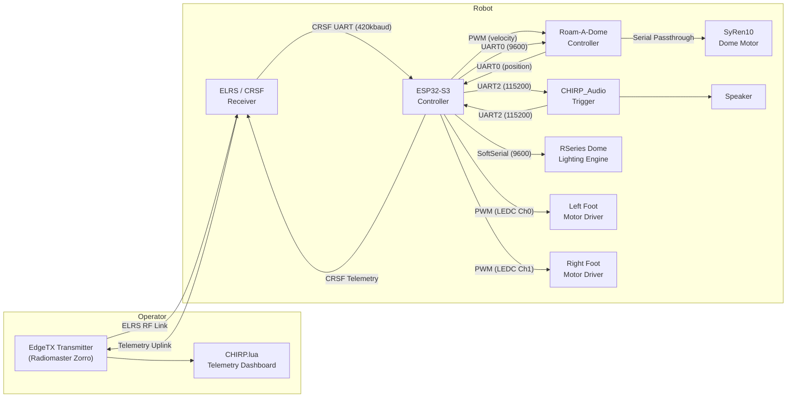
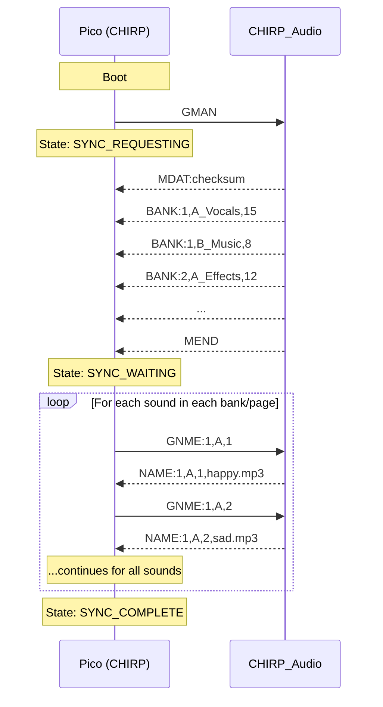
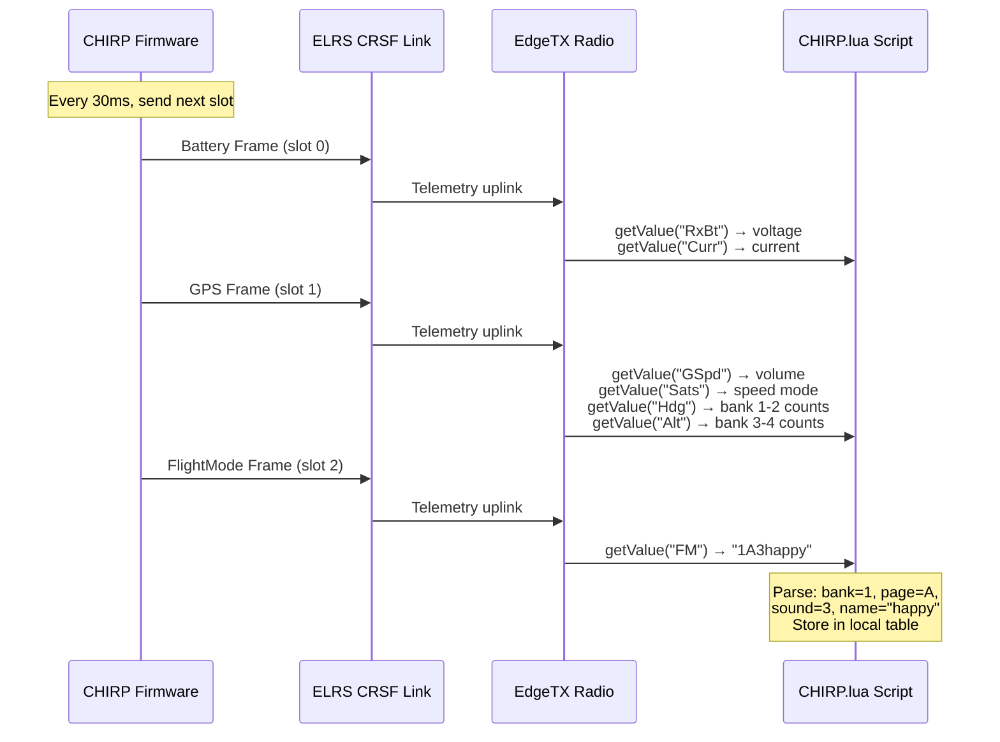

# CHIRP Droid Control — System Overview

This is control firmware for an R2-D2 style mobile robot. It runs on an **Espressif ESP32-S3** (Waveshare ESP32-S3 Zero and ESP32-S3 DevKit) and is operated remotely via an EdgeTX transmitter over an **ExpressLRS** or **Crossfire** RC radio link (initially optimized for the **Radiomaster Zorro**, with future support for additional EdgeTX form factors like the TX16S, Boxer, and Pocket). A companion **Lua telemetry script** on the transmitter provides a live sound dashboard, settings editor, and diagnostics display.

> [!NOTE]
> **Active Architecture Notice**: The active firmware targets the **ESP32-S3**. See [DEVELOPMENT_PLAN.md](file:///c:/Users/Paul/Documents/GitHub/CHIRP/CHIRP_Droid_Control/DEVELOPMENT_PLAN.md) for the phased roadmap, pinouts, and architecture. The prior Raspberry Pi Pico 2 W prototype is archived in `firmware-pico2/`.

This document describes the system architecture, data flows, and design rationale as implemented in the firmware.

---

## Table of Contents

- [System Architecture](#system-architecture)
- [Hardware & Pin Assignments](#hardware--pin-assignments)
- [Operator Setup Guide: Transmitter & Receiver Configuration](#operator-setup-guide-transmitter--receiver-configuration)
  - [1. Receiver Wiring & Link Verification](#1-receiver-wiring--link-verification)
  - [2. EdgeTX Telemetry Discovery ("Discover New")](#2-edgetx-telemetry-discovery-discover-new)
  - [3. ExpressLRS & CRSF Failsafe Architecture](#3-expresslrs--crsf-failsafe-architecture)
  - [4. Multi-Layer Safety Architecture](#4-multi-layer-safety-architecture)
  - [5. Operator Bench Verification Checklist](#5-operator-bench-verification-checklist)
- [RC Channel Map (Radiomaster Zorro Profile)](#rc-channel-map-radiomaster-zorro-profile)
- [Sound Playback System](#sound-playback-system)
- [Audio Manifest Sync](#audio-manifest-sync)
- [Telemetry System](#telemetry-system)
- [Lua Telemetry Script](#lua-telemetry-script-chirplua)
- [Dome Control](#dome-control)
  - [SyRen 10 Driver Configuration & Failsafe DIP Switches](#syren-10-driver-configuration--failsafe-dip-switches)
- [Foot Drive](#foot-drive)
- [Autodome & Autochirp](#autodome--autochirp)
- [Debug Systems](#debug-systems)
- [File Structure](#file-structure)

---

## System Architecture



### Data Flow Summary

| Path | Purpose | Protocol |
|------|---------|----------|
| Transmitter → ELRS → ESP32-S3 | RC channel values (sticks, switches, knobs) + CRSF `0x32` Commands | CRSF @ 420000 baud |
| ESP32-S3 → ELRS → Transmitter | Telemetry (battery, sound counts, diagnostics, sound names) | CRSF telemetry frames |
| ESP32-S3 → CHIRP_Audio | Play/stop commands, manifest requests, voice debug | Serial @ 115200 baud (UART2) |
| CHIRP_Audio → ESP32-S3 | Manifest data, sound names, command ACKs | Serial @ 115200 baud (UART2) |
| ESP32-S3 → Roam-A-Dome | Dome velocity (PWM) + serial commands | PWM + Hardware UART0 @ 9600 |
| Roam-A-Dome → ESP32-S3 | Dome position reports | Hardware UART0 @ 9600 |
| ESP32-S3 → Dome Lighting | Marcduino / RSeries script animation triggers | SoftSerial @ 9600 baud |
| ESP32-S3 → USB | Debug serial output & live logs | Native USB CDC @ 115200 baud |

---

## Hardware & Pin Assignments

The ESP32-S3 architecture utilizes non-strapping GPIOs on the Waveshare ESP32-S3 Zero and ESP32-S3 DevKitC-1 N16R8.

### Peripheral & UART Allocation

| Interface | Peripheral | Baud Rate | TX Pin | RX Pin | Notes |
|-----------|------------|-----------|--------|--------|-------|
| Native USB | Debug Logs & CLI | 115200 | — | — | Native USB CDC (`ARDUINO_USB_CDC_ON_BOOT=1`) |
| Serial1 (HW UART1) | CRSF / ELRS Link | 420000 | GP4 | GP5 | Connect GP4 → RX on Receiver, GP5 → TX on Receiver |
| Serial2 (HW UART2) | CHIRP_Audio Trigger | 115200 | GP1 | GP2 | Bidirectional sound commands & manifest sync |
| Serial0 (HW UART0) | Roam-A-Dome (RAD) | 9600 | GP43 | GP44 | Dome velocity/autodome commands & position feedback |
| SoftSerial | Dome Lighting Engine | 9600 | GP12 | GP13 | Marcduino RSeries logic display animation triggers |

### PWM Outputs & Analog Sensing

| Function | Pin | Hardware Type | Configuration / Signal |
|----------|-----|---------------|------------------------|
| Left Foot Motor PWM | GP6 | LEDC Ch0 (50Hz) | 1000–2000 µs (1500 µs neutral, 25 µs deadband) |
| Right Foot Motor PWM | GP7 | LEDC Ch1 (50Hz) | 1000–2000 µs (1500 µs neutral, 25 µs deadband) |
| Dome Motor PWM | GP11 | LEDC Ch2 (50Hz) | 1000–2000 µs (1500 µs neutral, to Roam-A-Dome) |
| Battery 1 Voltage | GP8 | ADC1_CH7 | Primary 12V/24V foot drive battery voltage |
| Battery 2 Voltage | GP9 | ADC1_CH8 | Audio amplifier / sound system battery voltage |
| Battery 3 Voltage | GP10 | ADC1_CH9 | Aux / dome subsystem battery voltage |
| Status NeoPixel | GP21 / GP48 | WS2812B RGB | GP21 on S3-Zero, GP48 on DevKitC-1 N16R8 |
| Spare / Aux Pin | GP3 | GPIO Output | Isolated strapping pin (output-only) |

---

## Operator Setup Guide: Transmitter & Receiver Configuration

This section covers the initial setup of your EdgeTX transmitter (e.g. Radiomaster Zorro, TX16S, Boxer, Pocket) and ExpressLRS / Crossfire receiver. **Follow these steps before operating the droid.**

### 1. Receiver Wiring & Link Verification

- **Serial Connection to ESP32-S3**:
  - Receiver TX → ESP32-S3 **GP5** (`PIN_CRSF_RX` / Hardware UART1)
  - Receiver RX → ESP32-S3 **GP4** (`PIN_CRSF_TX` / Hardware UART1)
  - Receiver VCC / GND → Regulated **5V** and Common Ground
  - Operating baud rate: **420,000 baud** (CRSF standard)
- Verify RF link: Solid LED on the receiver and link telemetry (`1RSS`/`RQly`) visible on the handset.

### 2. EdgeTX Telemetry Discovery ("Discover New")

When initially pairing the transmitter to the robot, you **must** discover telemetry sensors in EdgeTX so the radio registers their sensor IDs into the active model configuration.

> [!IMPORTANT]
> **Mandatory Setup Step**: EdgeTX will **not** pass telemetry data to Lua scripts (like `CHIRP.lua`) or telemetry display widgets until the sensors have been discovered. If you skip this step, battery voltages, current draw, volume, and sound names will not appear on your transmitter.

**Step-by-step discovery procedure:**
1. Power on the droid (both the ESP32-S3 and the receiver). Ensure the CHIRP firmware is running and actively transmitting CRSF telemetry uplink frames.
2. Power on the EdgeTX transmitter and confirm the RF link is active.
3. Long-press the **`MDL`** button to enter the **Model Menu**.
4. Page over (using `PAGE >`) to the **Telemetry** page (typically Page 11 or 12 depending on EdgeTX version).
5. Scroll down to the sensors list and select **"Discover New"** (or **"Discover new sensors"**).
6. Verify that the following sensors appear and start updating live:
   - `RxBt`: Multiplexed 3-battery voltage monitor (Primary Drive, Audio, Aux/Dome)
   - `Curr`: Instantaneous drive and system current draw (Amperes)
   - `Capa`: Repurposed for peak current draw since boot (Amperes)
   - `GSpd`: Repurposed for master audio volume (0–99%)
   - `Sats`: Packed system status (Drive Arm/Disarm, Speed Mode, Autodome, Autochirp)
   - `Hdg`: Active page sound counts for Banks 1 & 2
   - `Alt` (or `GAlt`): Active page sound counts for Banks 3 & 4
   - `FM`: Streaming Flight Mode string carrying sound names, page names, and manifest data
   - `1RSS`, `2RSS`, `RQly`, `TPWR`: ExpressLRS / Crossfire RF link health metrics
7. Once all sensors are populated and values are actively streaming, select **"Stop Discover"**.

> [!WARNING]
> Always select **"Stop Discover"** once discovery is complete. Leaving discovery running increases CPU load on the transmitter and can create duplicate or ghost sensor IDs if nearby transmitters or RF sources are active.

### 3. ExpressLRS & CRSF Failsafe Architecture

In drone and robotics systems running ExpressLRS over a serial UART link (**CRSF protocol**), failsafe behavior operates fundamentally differently from legacy PWM/PPM systems:

#### How CRSF Serial Failsafe Operates
- **No Receiver-Side Channel Programming**: When using an ExpressLRS serial receiver wired to a flight controller or microcontroller, you do **not** configure channel fallback positions on the receiver or in the transmitter's "Custom Failsafe" menu. 
- **Digital Link-Loss Signaling**: When an ExpressLRS receiver loses the RF link from the transmitter, it simply **stops transmitting valid CRSF packets** over the UART (or signals a link-down flag). The receiver does not synthesize fake or held channel pulses to the microcontroller.
- **The ESP32-S3 Acts as the Flight Controller**: Because CRSF is a digital packet stream, the flight controller firmware running on the ESP32-S3 is completely in charge of detecting signal loss and executing the failsafe response:
  - The `CrsfLink` engine in the ESP32-S3 monitors the interval since the last valid CRSF frame (`g_robotState.lastValidCrsfMs`).
  - If no valid frames arrive within **250ms** (`RC_FAILSAFE_TIMEOUT_MS`), the ESP32-S3 immediately engages its failsafe sequence:
    1. Sets `rcLinkUp = false`
    2. Instantly disarms foot drive (`isArmed = false`)
    3. Overrides foot drive PWM outputs (`GP6` and `GP7`) to exactly **1500 µs (neutral)**
    4. Overrides dome motor PWM (`GP11`) to exactly **1500 µs (neutral)**
    5. Locks speed mode back to `SLOW`
    6. Triggers the voice prompt `"warning receiver disconnected"`

#### Physical Power States & Motor Safety
A key safety question in astromech droids is: **What happens to the motors if the ESP32-S3 is powered off, rebooting, or being flashed, while the receiver remains powered on the droid's 5V bus?**
- **Direct Controller Isolation**: The foot motor drivers (e.g. Sabertooth, Roboteq) and dome driver (SyRen10 via Roam-A-Dome) are connected to the **ESP32-S3's PWM pins (`GP6`, `GP7`, `GP11`)**, not to the receiver.
- **ESP32 Powered Off**: When the ESP32 is powered off or held in reset, its GPIO pins are in a high-impedance (unpowered) floating state. Because no 50Hz PWM pulse train is being generated, modern motor controllers enter their built-in **signal-loss shutdown mode** (neutral/freewheel or brake). The motors will not move. *(Note: For the dome motor, ensure the SyRen 10's **DIP Switch 6 is UP** for Timeout Failsafe and **DIP Switch 4 is UP** for standard R/C mode, otherwise it will continue driving or latch onto floating wire noise—see [SyRen 10 Driver Configuration](#syren-10-driver-configuration--failsafe-dip-switches)).*
- **ESP32 Booting Up**: When the ESP32 boots, firmware initialization immediately configures the LEDC hardware PWM channels to output a solid **1500 µs neutral pulse**, with drive motors forced into the Disarmed state until an explicit, valid arming sequence is received.
- *(Note on Standalone PWM Receivers)*: If you ever use an ExpressLRS receiver with native PWM servo pins directly connected to motors without a microcontroller, failsafe positions must be set in the ELRS WebUI or via the handset Lua script. However, in the CHIRP architecture, the ESP32-S3 acts as the intelligent flight controller and manages all PWM signals directly.

### 4. Multi-Layer Safety Architecture

CHIRP implements defense-in-depth across 4 integrated safety layers to guarantee that foot and dome movement remain centered and stopped:

| Safety Layer | Trigger / Condition | System Response |
| :--- | :--- | :--- |
| **1. CRSF Digital Link Loss** | Transmitter turned off or RF signal lost | ELRS receiver ceases UART packet transmission; ESP32-S3 detects packet loss within 250ms. |
| **2. ESP32 Zero-Latency Watchdog** | >250ms gap in valid CRSF packets | `CrsfLink` auto-disarms, forces foot & dome PWM outputs to `1500 µs` (neutral), and plays a voice warning. |
| **3. Boot-Disarm Interlock** | System powers up with Arm Switch `SE` in the Armed position | Foot drive is locked out at neutral until the operator cycles switch `SE` back to Disarmed (`< 1200 µs`). |
| **4. Slow-on-Arm Protection** | Initial arming of foot drive via switch `SE` | Speed mode is forced to SLOW (`30%`) regardless of switch `SB` position until `SB` is physically moved. |

### 5. Operator Bench Verification Checklist

Always perform these safety verification tests on a test stand before driving:
- [ ] **Test 1 — Transmitter Off Failsafe**: With the robot powered on and armed on a stand, switch off the transmitter. Verify that both foot motors and dome immediately stop (`1500 µs`), the ESP32 status LED indicates link loss, and the voice announcement says *"warning receiver disconnected"*.
- [ ] **Test 2 — ESP32 Power Cycle / Reset**: With the receiver and motor power active, press the Reset button or power-cycle the ESP32. Verify that no motor twitches or dome rotations occur during reboot.
- [ ] **Test 3 — Boot-Disarm Lock**: Turn on the transmitter with switch `SE` in the Armed position, then power on the ESP32. Confirm the motors remain disarmed and the log confirms an arm switch cycle is required.

---

## RC Channel Map (Radiomaster Zorro Profile)

The active channel map aligns directly with the Radiomaster Zorro EdgeTX configuration (`model09.yml`):

| Channel | Function | Physical Input | Default / Safe Position | Target Peripheral / Behavior |
|:-------:|:---------|:--------------:|:-----------------------:|:-----------------------------|
| **CH1** | Differential Steering | Right Stick X | Center (1500 µs) | Foot Drive Motor Steering mixing |
| **CH2** | Throttle (Forward / Reverse) | Right Stick Y | Center (1500 µs) | Foot Drive Motor Throttle mixing |
| **CH3** | Reserved / Aux | Left Stick Y | Center (1500 µs) | Reserved for future head pitch / periscope |
| **CH4** | Dome Yaw Rotation | Left Stick X | Center (1500 µs) | Roam-A-Dome SyRen10 Velocity (±20 µs deadband) |
| **CH5** | Foot Drive Arm Interlock | Switch `SE` (2-pos) | UP / Disarmed (1000 µs) | Enforces boot-disarm safety lock |
| **CH6** | Speed Mode | Switch `SB` (3-pos) | UP / Slow (1000 µs) | Slow (30%), Medium (70%), Fast (100%) |
| **CH7** | Autodome Mode | Switch `SC` (3-pos) | UP / Off (1000 µs) | Off (1000 µs), Low Freq (1500 µs), High Freq (2000 µs) |
| **CH8** | Master Audio Volume | Dial `S2` | Full CCW (1000 µs = 0%) | Live Audio Trigger Volume (0–99%) |
| **CH9** | Sound Trigger Fallback | Handset Mix | Neutral (1500 µs) | Optional pulse-based sound trigger fallback |

### Handset Sound Triggering & CRSF `0x32` Command Frames

Rather than packing sound buttons into analog channel slices, the **CHIRP EdgeTX Lua Dashboard** communicates directly with the ESP32 using bidirectional CRSF Command Frames (`0x32`):

- **Scroll Wheel `S1`**: Browses through tracks (1–24) in the active bank/page.
- **Button `SD`**: Triggers Bank 1 sound.
- **Button `SH`**: Triggers Bank 2 sound.
- **Button `SA`**: Triggers Bank 3 sound.
- **Button `SG`**: Triggers Bank 4 sound.
- **Combo `SD + SA`**: Instantly halts all audio playback (`CHIRP_CMD_STOP_AUDIO`).
- **Telemetry Backchannel**: Adjusting settings (such as motor inversion or speed limits) on Screen 3 transmits `0x32` packets back to the ESP32, which stores them into onboard NVS flash.

*(Note: For radios without Lua script support, the firmware also retains a universal fallback on **CH9** that converts pulse widths from 1050–2000 µs into any of the 288 sound coordinates).*

---

## Sound Playback System

### Sound Organization

Sounds on the CHIRP_Audio SD card are organized into **Banks** and **Pages**:

- **Banks** (up to 4 on Zorro): Each of the 4 trigger buttons plays from a different bank
- **Pages** (A, B, C): Sub-groups within each bank, switchable via a 3-pos switch
- **Sounds**: Up to 24 sounds per page, selected by the Sound Index knob

```
SD Card/
├── 1_A_Vocals/       ← Bank 1, Page A
│   ├── happy.mp3
│   ├── sad.mp3
│   └── ...
├── 1_B_Music/        ← Bank 1, Page B
├── 2_A_Effects/      ← Bank 2, Page A
└── ...
```

### Sound Selection Flow

1. Operator turns the **Sound Index knob** (Ch 7) to browse sounds in a bank
2. The knob value (988–2012 µs) is mapped to the sound count of that bank's current page
3. Pressing a **trigger button** (Ch 8) enters a zone (1–4)
4. **Releasing** the button triggers playback of the selected sound from that zone's bank
5. The Pico sends `PLAY:soundIndex,bankIndex,pageChar,volume` to CHIRP_Audio over UART2

**Bank 1 exception**: Always uses Page A regardless of the page switch position (Bank 1 is configured directly on the CHIRP_Audio board).

---

## Audio Manifest Sync

The biggest improvement over the original CHIRP_Core — manifest sync is now **completely non-blocking**. The robot remains fully operational while sound names are being loaded.

### Protocol Sequence



### State Machine

| State | Description | Timeout Behavior |
|-------|-------------|-----------------|
| `SYNC_IDLE` | Initial state | — |
| `SYNC_REQUESTING` | Sent `GMAN`, waiting for `MDAT`/`BANK`/`MEND` | Retries `GMAN` after 1 second |
| `SYNC_WAITING` | Requesting individual sound names via `GNME` | Retries current `GNME` after 1 second |
| `SYNC_COMPLETE` | All names loaded | — |

**During sync**, sound names display as placeholders (`"Snd 1"`, `"Snd 2"`, etc.) on the Lua dashboard. Once each name is received, it replaces the placeholder in real time.

### Manifest Data Structures (in RAM)

```cpp
AudioManifest manifest;
  └── banks[4]              // 4 SoundBanks
       └── pages[3]         // 3 BankPages per bank (A, B, C)
            ├── name[12]    // Page display name
            ├── soundCount  // Number of sounds on this page
            └── sounds[24]  // Up to 24 Sounds
                 └── name[12]  // Sound display name (max 11 chars)
```

---

## Telemetry System

The Pico sends telemetry data upstream through the CRSF link to the EdgeTX transmitter. Because CRSF has limited bandwidth and specific frame types, CHIRP uses a **round-robin scheduler** and creative data packing to transmit everything the Lua dashboard needs.

### Round-Robin Schedule

The scheduler cycles through 3 telemetry slots at 30ms per slot (each type updates ~11 times per second):

| Slot | CRSF Frame Type | Content |
|------|----------------|---------|
| 0 | Battery Sensor (`0x08`) | Multi-battery voltage + current draw |
| 1 | GPS (`0x02`) | Sound counts, volume, speed mode |
| 2 | Flight Mode (`0x21`) | Sound/page name strings |

### Slot 0 — Battery Sensor Frame

The standard CRSF Battery Sensor frame has 4 fields. CHIRP repurposes them:

| Field | Standard CRSF Use | CHIRP Use |
|-------|------------------|------------|
| `voltage` | Battery voltage | Multi-battery voltage (offset encoding) |
| `current` | Current draw | Instantaneous current draw (100mA units) |
| `capacity` | mAh consumed | Peak current since boot (repurposed) |
| `remaining` | Battery % | Fixed at 100 |

#### Multi-Battery Offset Encoding

The firmware has a single `voltage` field but needs to report up to 3 batteries. It cycles through them and adds an offset so the Lua script can tell which battery is being reported:

| Cycle | Value Sent | Lua Decoding |
|-------|-----------|-------------|
| 0 | `battery1 × 10` | Raw value < 1000 → Primary battery voltage |
| 1 | `(battery2 × 10) + 1000` | Value ≥ 1000 and < 2000 → Secondary (subtract 1000, divide by 10) |
| 2 | `(battery3 × 10) + 2000` | Value ≥ 2000 → Tertiary (subtract 2000, divide by 10) |

Example: Primary = 12.2V → sent as `122`. Secondary = 11.9V → sent as `1119`. The Lua script decodes them into separate display values.

### Slot 1 — GPS Frame (Sound Counts & Status)

The GPS frame fields are repurposed for system status:

| GPS Field | CHIRP Data | Encoding |
|-----------|------------|----------|
| `groundspeed` | Volume | `volume × 10` |
| `satellites` | Speed mode | 0 = disarmed, 1 = slow, 2 = med, 3 = fast |
| `heading` | Sound counts for Banks 1–2 | Bit-packed: bits 0–4 = Bank 1 count, bits 5–9 = Bank 2 count |
| `altitude` | Sound counts for Banks 3–4 | Bit-packed: bits 0–4 = Bank 3 count, bits 5–9 = Bank 4 count, plus 1000 offset |

#### Sound Count Bit-Packing

Each bank's sound count (0–24) fits in 5 bits. Two counts are packed into a single 16-bit field:

```
heading = (bank1_count & 0x1F) | ((bank2_count & 0x1F) << 5)
altitude = ((bank3_count & 0x1F) | ((bank4_count & 0x1F) << 5)) + 1000
```

The Lua script unpacks them with bitwise AND and right-shift operations. The `altitude` field has a +1000 offset because EdgeTX subtracts 1000 from raw altitude values.

### Slot 2 — Flight Mode Frame (Sound Names)

This is how sound and page names are delivered to the Lua dashboard. The Flight Mode frame carries a short string (up to 14 bytes). CHIRP formats it as:

```
<bankDigit><pageChar><soundChar><name...>
```

| Byte | Content | Example |
|------|---------|---------|
| 1 | Bank number (1–4) | `1` |
| 2 | Page letter (A, B, C) | `A` |
| 3 | Sound index character | `0` = page name, `1`–`9` = sound 1–9, `a`–`z` = sound 10–35 |
| 4–14 | Name string (max 11 chars) | `happy` |

**Example Flight Mode strings:**
- `1A0Vocals` — Bank 1, Page A, page name is "Vocals"
- `1A1happy` — Bank 1, Page A, Sound 1 is "happy"
- `2B3laser` — Bank 2, Page B, Sound 3 is "laser"

The firmware cycles through all banks, pages, and sounds in order, sending one name per telemetry slot. A complete cycle through all names takes several seconds depending on how many sounds are loaded. The Lua script parses the 3-byte header and stores each name in its local cache.

### Telemetry Data Flow (End to End)



---

## Lua Telemetry Script (CHIRP.lua)

The EdgeTX Lua script runs on the transmitter and provides three pages of display.

### Telemetry Sensor Mapping

| EdgeTX Sensor | Source Frame | CHIRP Data | Lua Decoding |
|---------------|-------------|------------|--------------|
| `RxBt` | Battery `0x08` | Multi-battery voltage | < 1000 → Primary, ≥ 1000 → Secondary − 1000, ≥ 2000 → Tertiary − 2000 |
| `Curr` | Battery `0x08` | Instantaneous current | Direct (÷10 for amps) |
| `Capa` | Battery `0x08` | Peak current since boot | Repurposed capacity field (÷10 for amps) |
| `GSpd` | GPS `0x02` | Volume | ÷ 10 for 0–100 |
| `Sats` | GPS `0x02` | Speed mode | 0 = disarmed, 1/2/3 = slow/med/fast |
| `Hdg` | GPS `0x02` | Sound counts (Banks 1–2) | Unpack: `bank1 = val & 0x1F`, `bank2 = (val >> 5) & 0x1F` |
| `Alt` | GPS `0x02` | Sound counts (Banks 3–4) | Subtract 1000 offset, then unpack same as Hdg |
| `FM` | FlightMode `0x21` | Sound/page name | Parse 3-byte header + name string |

### Sound Name Retrieval Pipeline

The Lua script builds its complete sound name database through this pipeline:

1. **Firmware boots** → requests manifest from CHIRP_Audio → learns how many sounds are in each bank/page
2. **Firmware syncs names** → requests each sound name via `GNME` → stores in RAM
3. **Telemetry sends names** → Flight Mode frame cycles through all bank/page/sound combinations, sending one name every 90ms (3 slots × 30ms)
4. **Lua receives names** → parses the 3-byte header, stores in a local `soundNames[bank][page][sound]` table
5. **Lua displays names** → maps the Sound Index knob position to the correct sound in the current bank/page and highlights it on screen

The Lua script also caches names to `/SCRIPTS/TELEMETRY/chirp_cache.txt` so the dashboard populates faster on subsequent boots (before the full telemetry cycle completes).

### Page 1 — Sound Dashboard (Default)

Shows the currently selected sound for each of the 4 banks in a split-screen layout. The Sound Index knob position determines which sound is highlighted in each bank. Sound names update live as telemetry arrives.

### Page 2 — Diagnostics

Shows detailed system status:
- All battery voltages (primary, secondary, tertiary)
- Instantaneous and peak current draw
- Speed mode, dome position angle
- Autodome and Autochirp on/off status
- Link quality
- Placeholder for future WiFi integration

### Page 3 — Settings

Allows the operator to view and modify system configuration variables directly from the transmitter:
- Bank 1 Page selection
- Dome motor parameters (Offset, Invert)
- Voice Debug toggle
- Foot drive motor inversion
- Speed multipliers (Slow, Medium, Fast percentages)

#### Telemetry Backchannel

When a setting is changed, the Lua script sends the new value back to the robot via a CRSF Telemetry Push using a `COMMAND` frame (`0x32`). 
The custom single-pass `CrsfLink` engine intercepts incoming `0x32` command packets, verifies their 8-bit CRC (`0xD5` polynomial), and updates the system configuration structure. The updated configuration is then saved persistently to the ESP32-S3's onboard non-volatile flash memory using the `NVS` storage manager (`storage_manager`) so that settings survive reboots.

---

## Dome Control

The dome (R2-D2's head) uses a **SyRen10** motor driver managed through a **Roam-A-Dome** controller.

### Control Methods

| Method | Path | Purpose |
|--------|------|---------|
| PWM | ESP32-S3 GP11 → Roam-A-Dome PWM input | Manual velocity control from Ch 4 (Yaw stick) |
| Serial CMD | ESP32-S3 GP43/GP44 → Roam-A-Dome serial | Autodome commands (`:DPDR angle`) via Hardware UART0 |
| Serial Feedback | Roam-A-Dome → ESP32-S3 GP44 | Position reports (`#DP@angle`) every 100ms via Hardware UART0 |

### Manual Control

When the Yaw stick (Ch 4) moves beyond the deadzone (±25µs from 1500µs center), the raw stick value is written directly as a 50Hz PWM signal to the Roam-A-Dome. Returning the stick to center stops dome rotation immediately.

### Autodome

When autodome is active (enabled via Switch `SC` / Ch 7) and no manual override is occurring, the firmware periodically sends `:DPDR<angle>` commands (random ±90°) via Hardware UART0. Autodome pauses instantly if manual Yaw stick input is detected.

### SyRen 10 Driver Configuration & Failsafe DIP Switches

When controlling the dome via 50Hz PWM (either directly from the ESP32 or passed through a Roam-A-Dome controller), **proper DIP switch configuration on the SyRen 10 is critical to prevent runaway dome rotation**.

#### Recommended DIP Switch Settings (Standard R/C Mode + Timeout Failsafe):

| Switch | Position | Setting | Purpose / Critical Safety Behavior |
|:------:|:--------:|:--------|:-----------------------------------|
| **1** | **DOWN** | Mode 2: R/C Input | Configures terminal S1 for standard 50Hz hobby servo PWM (paired with Switch 2). |
| **2** | **UP** | Mode 2: R/C Input | Completes Mode 2 selection. |
| **3** | **UP** | Battery Cutoff | Lithium cutoff disabled (set DOWN only if powering directly from a bare lithium battery without BMS). |
| **4** | **UP** | **Standard R/C (Fixed 1500 µs Center)** | **CRITICAL**: Disables auto-calibration. Guarantees 1500 µs is always stopped neutral. If set DOWN (Auto-Calibrate), powering on the SyRen while the ESP32 is off or booting can cause the SyRen to calibrate on 0V and spin at full speed once 1500 µs pulses start! |
| **5** | **UP** | Standard Single-Motor Control | Selects single-channel velocity/direction control on S1. |
| **6** | **UP** | **R/C Timeout Failsafe ENABLED** | **CRITICAL**: Brings the dome motor to an immediate stop if PWM servo pulses are interrupted or lost. If set DOWN, the SyRen will continue running at the last commanded speed or latch onto electrical noise when the microcontroller is powered down! |

```
 SyRen 10 DIP Switch Configuration (Standard R/C + Failsafe):
  [ON / UP]      |   2   3   4   5   6  |
                 +----------------------+
  [OFF / DOWN]   | 1                    |
```

> [!WARNING]
> **DIP Switch 6 (Failsafe Timeout) MUST be UP**: If Switch 6 is left in the DOWN position, the SyRen will continue spinning the dome whenever the ESP32 is powered off, rebooting, or flashing.
> 
> **DIP Switch 4 (Standard R/C) MUST be UP**: Do **not** use Auto-Calibrate (Switch 4 DOWN). Microcontroller boot sequences can cause the SyRen to learn an erroneous 0V baseline as center, causing the dome to spin at full throttle on startup.

> [!TIP]
> **Floating Input Hardware Protection**: When the ESP32-S3 powers off, its GPIOs become high-impedance. To prevent the long signal wire to terminal S1 from acting as an antenna picking up EMI from motors, install a **10kΩ pull-down resistor** between SyRen terminal **S1** and **0V (GND)**. When the ESP32 is powered off, this holds S1 solidly at 0V, allowing the SyRen's Timeout Failsafe (Switch 6 UP) to immediately recognize loss of signal and clamp the motor at a complete stop.

---

## Foot Drive

The two foot motors use standard servo PWM signals with arcade-style tank mixing:

1. **Input**: Ch 1 (Steering) and Ch 2 (Throttle)
2. **Mixing**: `left = throttle + steering`, `right = throttle - steering`
3. **Speed scaling**: Applied based on the 3-pos speed switch `SB` (Ch 6) — Slow (30%), Medium (70%), Fast (100%)
4. **Output**: Hardware LEDC 50Hz PWM servo signals (1000–2000µs) on GP6 (Left) and GP7 (Right)
5. **Safety**: Motors are forced to stop (1500µs neutral) when disarmed (Switch `SE`) or when RC link is lost

---

## Autodome & Autochirp

Autodome and Autochirp provide autonomous life-like astromech behaviors.

### Autodome Mode (Switch `SC` / Ch 7)

When enabled, the dome periodically makes random rotations:
- **Switch Positions**:
  - `UP` (1000 µs): Disabled / Off
  - `MID` (1500 µs): Low Frequency (rotations every 15–45 seconds)
  - `DOWN` (2000 µs): High Frequency (rotations every 5–15 seconds)
- **Movement**: Sends `:DPDR<angle>` (random relative rotation, ±90°) to Roam-A-Dome
- **Override**: Any manual dome input (Ch 4) pauses autodome until the stick returns to center

### Autochirp Mode

When enabled, the robot periodically plays an autonomous vocalization:
- **Interval**: Random 15–45 seconds
- **Sound selection**: Plays from the active bank/page based on current sound selection
- **Command**: Sends `PLAY:index,bank,page,volume` to CHIRP_Audio

---

## Debug Systems

CHIRP has two independent debug systems that can be enabled/disabled separately.

### Serial Debug (`DEBUG_ENABLED`)

Outputs structured messages to USB serial (115200 baud) with category filtering:

| Category | Bitmask | Content |
|----------|---------|---------|
| `DBG_GENERAL` | `0x01` | Boot sequence, periodic status dump |
| `DBG_CRSF` | `0x02` | RC link state, arm/disarm, channel values |
| `DBG_AUDIO` | `0x04` | Manifest sync TX/RX, play/stop commands |
| `DBG_DRIVE` | `0x08` | Motor output values |
| `DBG_DOME` | `0x10` | Manual override, autodome, RAD position |
| `DBG_TELEM` | `0x20` | Telemetry frame contents |

**Three output modes:**
- `DBG()` / `DBG_EVENT()` — Print immediately (used in `setup()` and for state changes)
- `DBG_THROTTLE()` — Rate-limited (used in `loop()` for high-frequency data)

A periodic status dump runs every 5 seconds:
```
[5000 ms] [STATUS] LINK:UP ARM:Y SPD:2 VOL:75 B1:12.2v B2:11.9v DOME:127 PG:A ADome:1 AChirp:0 SYNC:COMPLETE
[5000 ms] [CRSF] CH 1-8:  1500 1500 1500 1500 1988 1200 1650 1500
[5000 ms] [CRSF] CH 9-16: 1500 1500 1500 1500 1200 1500 1500 1500
```

When `DEBUG_ENABLED` is commented out, all debug code compiles away to zero overhead.

### Voice Debug (`DEBUG_VOICE_ENABLED`)

Sends `PVOICE:word` commands to CHIRP_Audio, which has ~150 system audio files baked into firmware (numbers 0–100, alphabet A–Z, and words like "armed", "battery", "dome", etc.). Multi-word phrases are queued and played sequentially with ACK handshaking.

Example announcements:
- Boot: *"chirp control ready"*
- Armed: *"foot drives armed"*
- Link lost: *"warning receiver disconnected"*
- Battery low: *"warning primary battery low"*
- Speed change: *"speed fast"*

---

## File Structure

```
CHIRP_Droid_Control/
├── firmware/                       # Active ESP32-S3 PlatformIO project
│   ├── platformio.ini              # Build configurations for S3-Zero & S3-DevKitC-1
│   ├── include/
│   │   ├── config.h                # Pin definitions, constants, data structures
│   │   ├── types.h                 # Thread-safe data structures & command queues
│   │   ├── crsf_link.h             # Sliding-window CRSF receiver & telemetry engine
│   │   ├── drive_control.h         # Foot motor arcade mixing & speed scaling
│   │   ├── dome_control.h          # Dome PWM & Roam-A-Dome UART controller
│   │   ├── dome_lighting.h         # RSeries dome lighting SoftSerial driver
│   │   ├── audio_link.h            # CHIRP_Audio protocol, manifest sync, play/stop
│   │   ├── telemetry.h             # ADC1 3-battery monitor & CRSF telemetry uplink
│   │   └── storage_manager.h       # ESP32 NVS non-volatile settings manager
│   └── src/
│       ├── main.cpp                # Dual-core FreeRTOS task entrypoints & RGB heartbeat
│       ├── crsf_link.cpp
│       ├── drive_control.cpp
│       ├── dome_control.cpp
│       ├── dome_lighting.cpp
│       ├── audio_link.cpp
│       ├── telemetry.cpp
│       └── storage_manager.cpp
├── lua/
│   ├── CHIRP2026.lua               # Active EdgeTX Telemetry & Direct CRSF 0x32 Lua Dashboard
│   └── legacy/
│       └── CHIRP2.lua              # Archived legacy Lua script
├── firmware-pico2/                 # Archived Raspberry Pi Pico 2 W prototype
├── model09.yml                     # Reference EdgeTX model configuration (Radiomaster Zorro)
├── DEVELOPMENT_PLAN.md             # Comprehensive roadmap, architecture & verification log
└── README.md                       # This document
```

### Dependencies & Toolchain

| Dependency | Purpose | Target |
|------------|---------|--------|
| [PlatformIO](https://platformio.org/) | Embedded build system & package manager | Core build system |
| `EspSoftwareSerial` | SoftwareSerial for Marcduino / RSeries dome lighting | PlatformIO library registry |
| `Adafruit NeoPixel` | Onboard WS2812B RGB status pixel driver | PlatformIO library registry |
| ESP-IDF / Arduino Core | ESP32-S3 dual-core FreeRTOS, LEDC PWM, NVS storage | PlatformIO espressif32 platform |

### Build Targets

- **Waveshare ESP32-S3-Zero** (Default compact board):
  ```bash
  pio run -e esp32-s3-zero
  pio run -e esp32-s3-zero -t upload
  ```
- **ESP32-S3-DevKitC-1 N16R8** (16MB Flash / 8MB Octal PSRAM):
  ```bash
  pio run -e esp32-s3-devkit
  pio run -e esp32-s3-devkit -t upload
  ```
